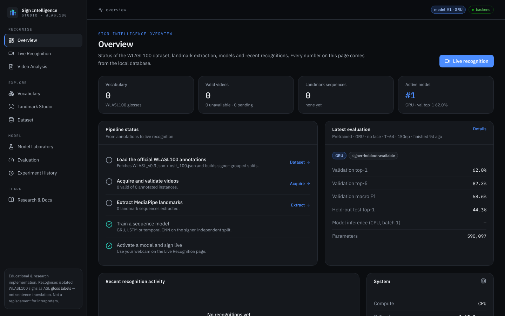
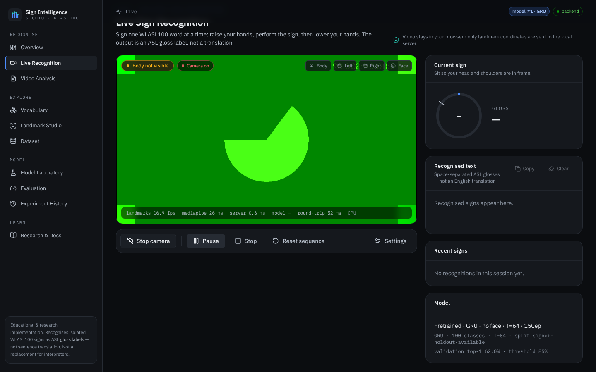
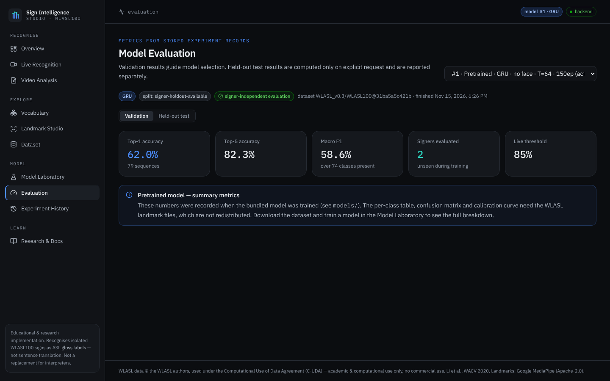
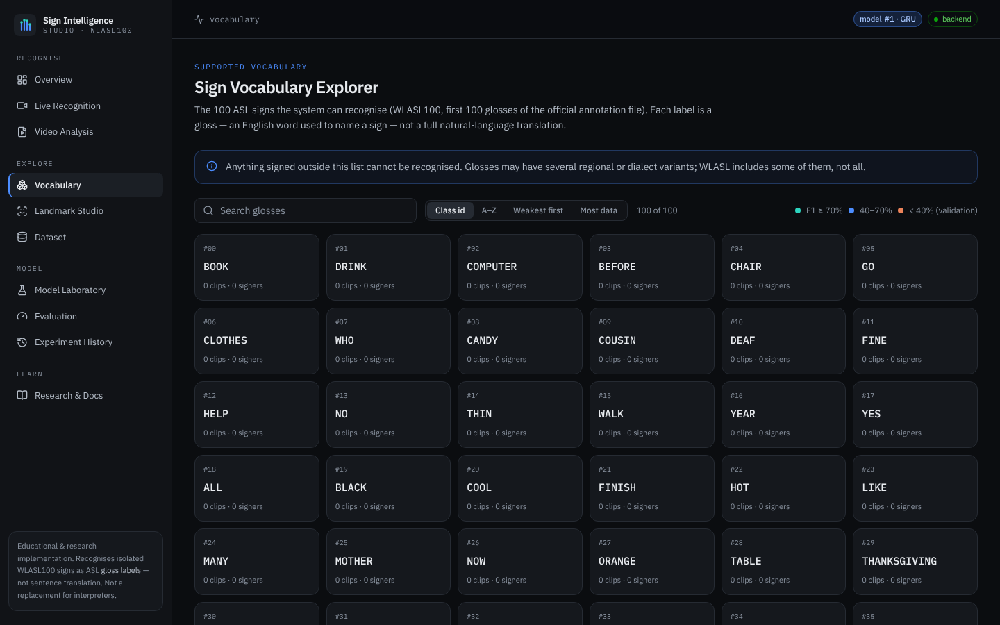
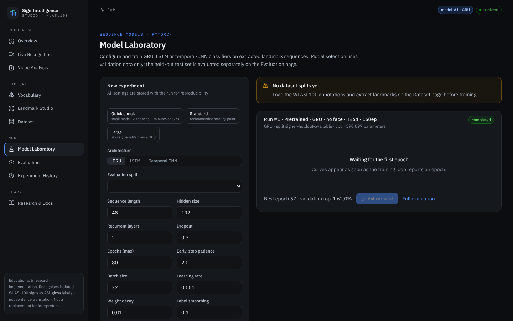

# Sign Intelligence Studio

**Real-time isolated American Sign Language (ASL) sign recognition on the WLASL100 vocabulary**, using MediaPipe Holistic landmarks, recurrent sequence models (GRU / LSTM, with a temporal-CNN baseline) and a live webcam pipeline.

> **Educational and research implementation.** It recognises *one isolated sign at a time* from a fixed 100-word vocabulary and outputs an ASL **gloss label**. It does not translate ASL sentences, does not model ASL grammar, and must not be used in place of a qualified interpreter. WLASL data is licensed for **non-commercial, computational use only** (C-UDA).

**Online demo (runs entirely in your browser):** https://huggingface.co/spaces/agrawalaarush08/sign-language-studio

**Current model** (`models/wlasl100-gru-signer-holdout`): bidirectional GRU trained on the 524 WLASL100 clips that could be downloaded (~5 per sign). Signer-independent results — validation top-1 62.0%; held-out test on 7 unseen signers: **top-1 44.3%, top-5 72.2%**. Live webcam accuracy will be lower. This model is **registered automatically the first time the backend starts**, so live recognition works straight after setup — no dataset download or training needed.

> **Indian Sign Language (ISL) on branch `claude/indian-sign-language`: phase 1, not yet trained.** The ISL code, the
> 12,442-entry ISLRTC vocabulary and the English + Hindi word list are in the repository, but **no trained ISL model is
> committed and no ISL accuracy has been measured yet**. On a fresh setup the ISL language reports `missing_models` and
> recognises only the user's own signs (**My signs**); dictionary words answer "Not sure". A quick test build
> (`python -m app.isl.cli smoke`, a few minutes of CPU on partial data) makes the whole flow run, but its results are mostly
> wrong and are labelled *smoke run* in the app. Hindi: 890 rows are hand-written, 11,552 are unreviewed machine translations,
> 0 are teacher-checked. Full training and evaluation happen in phase 2 (`docs/ISL_DESIGN.md` sections 11 and 15).
> Phase 2 status (25 Nov 2026): landmarks from every openly downloadable ISL source are still being ingested
> (`docs/DATASETS_ISL.md` section 3.6: the commercial-safe sources are expected to finish on 26 Nov; the OpenHands raw
> poses used by the research profile take days longer at the measured rate). One resumable command per profile,
> `scripts/phase2_train.sh --profile commercial-safe|research`, refuses to start until its data is complete, then trains
> and evaluates that profile (estimated 13-24 h each on 4 CPUs, not yet measured). Only its smoke mode has been run so far
> (`docs/ISL_DESIGN.md` 15.6 lists the exact commands).



---

## Contents

1. [What it does](#what-it-does)
2. [Screenshots](#screenshots)
3. [Tech stack](#tech-stack)
4. [Quick start (Windows)](#quick-start-windows)
5. [Quick start (Linux / macOS)](#quick-start-linux--macos)
6. [Using the application](#using-the-application)
7. [Architecture](#architecture)
8. [Command line](#command-line)
9. [Testing](#testing)
10. [Project structure](#project-structure)
11. [Limitations](#limitations)
12. [Documentation](#documentation)
13. [Licensing, attribution & citation](#licensing-attribution--citation)
14. [Deployment (Hugging Face)](#deployment-hugging-face)
15. [Status](#status)

## What it does

| Area | Summary |
|---|---|
| Dataset | Fetches the official WLASL annotations, selects **WLASL100** (first 100 glosses, cross-checked against the authors' `nslt_100.json`: 2,038 instances, 97 signers), downloads only those videos, validates them, and records every failure. |
| Landmarks | MediaPipe **Holistic**: 33 pose, 2 × 21 hand and a 20-point face subset per frame. The same model runs in Python (dataset/offline) and in the browser (live webcam). |
| Features | Aspect-corrected, shoulder-centred, scale-normalised body frame; wrist-relative hand shape; hand position; face subset; presence flags; velocities. Missing detections stay missing (flagged), never invented. |
| Models | Bidirectional **GRU** (primary), **LSTM**, **temporal CNN** with masked attention pooling (PyTorch, CPU or CUDA). |
| Evaluation | Official split (labelled *not* signer-independent) plus **signer-holdout** and **5-fold signer-grouped CV** splits; automated leakage checks; test set evaluated only on explicit request. |
| Live | Webcam → MediaPipe in the browser → landmark coordinates over a localhost WebSocket → sign-boundary detection, temporal-crop agreement, confidence/margin thresholds, cooldown and repeat suppression → gloss text. |
| UI | Ten pages: Overview, Live Recognition, Video Analysis, Vocabulary, Landmark Studio, Dataset Explorer, Model Laboratory, Evaluation, Experiment History, Research & Docs. |

## Screenshots

| | |
|---|---|
|  |  |
| **Live Recognition** — webcam → MediaPipe in the browser → gloss. (Captured with Chromium's synthetic fake camera, so no person is visible.) | **Evaluation** — validation and held-out-test results of the bundled pretrained model. |
|  |  |
| **Vocabulary** — the 100 WLASL100 glosses the model recognises. | **Model Laboratory** — train GRU / LSTM / TCN models with live training curves. |

## Tech stack

| Layer | Technologies |
|---|---|
| Frontend | React 19, TypeScript, Vite, Tailwind CSS 4, React Router, MediaPipe Tasks Vision (WASM), ONNX Runtime Web (static build), Vitest, Playwright |
| Backend | Python 3.11/3.12, FastAPI, Uvicorn, Pydantic, SQLAlchemy + SQLite, NumPy, pandas, scikit-learn, OpenCV, MediaPipe, PyTorch |
| ML | Bidirectional GRU (primary), LSTM, temporal CNN with masked attention pooling over hand/body/face landmark features |
| Data | WLASL v0.3 annotations → WLASL100 subset; signer-grouped splits with automated leakage checks |
| Deployment | Hugging Face static Space (ONNX in the browser) or Docker Space (full backend) |

## Quick start (Windows)

Requirements: **Windows 10/11**, **Python 3.12 or 3.11**, **Node.js 20+**, Chrome or Edge, a webcam. Optional: an NVIDIA GPU (CUDA), `ffmpeg` (needed only for the 162 ASLPro `.swf` videos).

```bash
winget install Python.Python.3.12
```

```bash
winget install OpenJS.NodeJS.LTS
```

```bash
winget install Gyan.FFmpeg
```

From the project folder, in PowerShell:

```bash
powershell -ExecutionPolicy Bypass -File .\setup.ps1
```

```bash
powershell -ExecutionPolicy Bypass -File .\start.ps1
```

| | |
|---|---|
| Frontend | http://localhost:5173 |
| Backend | http://localhost:8000 |
| API documentation | http://localhost:8000/docs |

```bash
powershell -ExecutionPolicy Bypass -File .\stop.ps1
```

* `setup.ps1` creates `.venv`, installs PyTorch (CUDA build when `nvidia-smi` finds a GPU, otherwise CPU; `-Cpu` forces CPU), backend and frontend dependencies, downloads the 13 MB MediaPipe model and initialises SQLite. It does **not** download WLASL or start training. `-Dev` adds test tools.
* `start.ps1` launches both servers in the background (logs in `.run/`), waits until they respond, and opens the browser (`-NoBrowser` to skip).
* `stop.ps1` stops only the processes `start.ps1` recorded.

## Quick start (Linux / macOS)

Requirements: **Python 3.12 or 3.11** (with `venv`), **Node.js 20+**, Chrome/Edge/Chromium, a webcam. On Debian/Ubuntu MediaPipe also needs `sudo apt install libegl1 libgles2 libgl1`.

```bash
./setup.sh            # add --cpu to force CPU PyTorch, --dev for test tools
```

```bash
./start.sh            # then open http://localhost:5173
```

```bash
./stop.sh
```

If ports 8000/5173 are taken: `BACKEND_PORT=8010 FRONTEND_PORT=5180 ./start.sh`. Logs are in `.run/`.

Manual alternative (any OS, two terminals):

```bash
python3.12 -m venv .venv && .venv/bin/pip install torch --index-url https://download.pytorch.org/whl/cpu
.venv/bin/pip install -r backend/requirements.txt && .venv/bin/python scripts/fetch_models.py
cd backend && ../.venv/bin/python -m uvicorn app.main:app --port 8000
```

```bash
cd frontend && npm ci && npm run dev
```

## Using the application

**Indian Sign Language (ISL, branch `claude/indian-sign-language`).** The header has a sign-language switch (ISL first, ASL second) and an EN / हिंदी interface switch. With ISL, Live Recognition shows each word in English and Hindi, asks "Did you mean…?" with up to five choices when it is not sure, and says "Not sure – try again or spell it" instead of guessing; the signed words become an approximate English and Hindi sentence that can be read aloud. **My signs** records 3–5 takes of a personal or regional (e.g. Indore) sign and shares signs as `.signpack` files; the Vocabulary page searches the whole ISLRTC dictionary in English or Hindi. Phase 1 status: no trained ISL model is committed, so a fresh setup recognises only My signs until the ISL models are built (see the note at the top). Design, data and honest accuracy notes: `docs/ISL_DESIGN.md`, `docs/DATASETS_ISL.md`; dataset licences (ISLRTC data: free, non-profit use only) in `docs/DATASETS_ISL.md`.

**Just want to try it?** After setup, open **Live Recognition → Start camera → Start recognition** — the bundled pretrained WLASL100 model is already active. The steps below are for downloading the dataset and training your own models.

1. **Dataset Explorer → Load annotations.** Downloads the two official annotation files, records their SHA-256, builds the WLASL100 inventory and the splits.
2. **Download & validate.** Start with a limit (e.g. 50) to see how your network fares; the full set is 2,038 instances. Expired links are recorded as *failed*. Videos the WLASL authors send you on request go in `data/videos/provided/<video_id>.mp4`, then **Scan local files**.
3. **Extract landmarks.** Runs MediaPipe Holistic over each validated clip (CPU; roughly 10–30 ms per frame depending on the machine).
4. **Model Laboratory → Start training.** The *Quick check* preset trains in minutes on a CPU; *Standard* is the recommended configuration. Curves stream from the real training loop.
5. **Activate** the best run, compare on **Evaluation**, and run the **held-out test** evaluation once you have finished selecting models.
6. **Live Recognition → Start camera → Start recognition.** Sit with head and shoulders in frame, raise your hands, sign one word, lower your hands. Settings let you change the mode (sign boundaries / sliding window), thresholds, processing resolution, MediaPipe processor (GPU/CPU) and overlays.

## Architecture

```
Browser (React + TypeScript)                       Local backend (FastAPI, Python)
┌─────────────────────────────────────┐            ┌─────────────────────────────────────────────┐
│ webcam ─► MediaPipe Holistic (WASM) │  landmarks │ WebSocket /api/ws/recognize                 │
│          GPU or CPU, local only     │ ─────────► │   RecognitionEngine (buffer, boundaries,    │
│ overlay, status, transcript         │ ◄───────── │   smoothing, thresholds) ─► Predictor (torch)│
└─────────────────────────────────────┘   states   │ REST: dataset, splits, experiments, jobs,   │
                                                    │   vocabulary, analysis, exports             │
                                                    │ Jobs: acquire ▸ validate ▸ extract ▸ train  │
                                                    │ SQLite (metadata/results) · data/ (videos,  │
                                                    │ landmarks) · artifacts/ (checkpoints)       │
                                                    └─────────────────────────────────────────────┘
```

* **One feature implementation** (`backend/app/features/build.py`) serves training, offline analysis and live inference. The browser sends raw landmarks in the layout published at `/api/features/spec`.
* **Privacy:** no webcam image ever leaves the browser; only coordinates go to `localhost`. Recognitions are stored as gloss + score only.
* **Why landmarks in the browser and the model on the backend:** browser MediaPipe avoids streaming video, while one Python model/feature path guarantees training–inference parity.

See [docs/METHODOLOGY.md](docs/METHODOLOGY.md) for the full method.

## Command line

All pipeline steps are also available without the UI (run inside `backend/` with the virtual environment active):

```bash
python -m app.cli annotations
```

```bash
python -m app.cli acquire --limit 100
```

```bash
python -m app.cli extract
```

```bash
python -m app.cli splits
```

```bash
python -m app.cli train --arch gru --split signer-holdout --epochs 80 --seq-len 48 --activate
```

```bash
python -m app.cli evaluate-test 1
```

```bash
python -m app.cli import-model            # (re-)register the pretrained model in models/
```

Environment variables (prefix `SLR_`): `SLR_DATA_DIR`, `SLR_ARTIFACTS_DIR`, `SLR_DEVICE` (`auto`/`cpu`/`cuda`), `SLR_TORCH_THREADS`, `SLR_DOWNLOAD_WORKERS`, `SLR_DOWNLOAD_TIMEOUT_S`, `SLR_IMPORT_BUNDLED_MODEL` (`true` by default; `false` skips registering the pretrained model on first start).

## Testing

```bash
cd backend; ..\.venv\Scripts\python -m pytest -q        # Windows
cd backend && ../.venv/bin/python -m pytest -q          # Linux / macOS
```

```bash
cd frontend; npm test
```

With the app running (`start.ps1` / `start.sh`), browser end-to-end tests use Chromium's fake camera (set `E2E_BASE_URL` if you changed the frontend port):

```bash
cd frontend; npx playwright install chromium; npx playwright test
```

`E2E_FAKE_VIDEO=<file.y4m>` feeds a video file as the fake camera.

GitHub Actions (`.github/workflows/ci.yml`) runs the backend pytest suite, the frontend typecheck, Vitest and production build, and a gitleaks secret scan of the git history on every push and pull request.

On a machine whose CPUs are busy (for example while `scripts/ingest_isl.py` runs), set `SLR_TORCH_THREADS=2` for the backend tests; otherwise PyTorch and MediaPipe threads compete and training tests slow down a lot.

Backend tests run against an isolated temporary data directory with **synthetic landmark sequences** (procedurally generated, clearly flagged). They verify the pipeline's wiring and logic, not ASL accuracy.

## Project structure

```
backend/
  app/
    api/          FastAPI routers (dataset, experiments, recognition + WebSocket, system)
    core/         settings, background jobs
    db/           SQLAlchemy models + session (SQLite)
    dataset/      annotations (WLASL100 selection), acquisition/validation, synthetic test data
    landmarks/    MediaPipe Holistic extractor, raw sequence format, batch pipeline
    features/     feature spec + normalisation/resampling/augmentation
    splits/       official / signer-holdout / signer-CV splits, leakage checks
    models/       GRU / LSTM / TCN networks, checkpoint + predictor, bundled-model import
    training/     dataset loading, training loop, test evaluation
    evaluation/   metrics (top-k, macro F1, per-class, confusion, calibration curve)
    inference/    streaming recognition engine, active-model registry
    cli.py        command-line interface
    main.py       app factory (docs at /docs)
  tests/          pytest suite
frontend/
  src/pages/      the ten pages
  src/recognition live state machine, WebSocket client, status model
  src/mediapipe/  browser Holistic loader, overlay drawing
  src/components/ UI kit and SVG/canvas charts
  e2e/            Playwright tests
models/                   pretrained WLASL100 GRU (checkpoint.pt, model.onnx, results.json)
scripts/                  MediaPipe model download, static export, Hugging Face deployment, e2e env
deploy/                   Hugging Face Space files (static + Docker)
docs/                     dataset, methodology, licensing, limitations, reproducibility, checklist, screenshots
data/  artifacts/  assets/   local only (git-ignored)
setup.ps1  start.ps1  stop.ps1   Windows scripts
setup.sh   start.sh   stop.sh    Linux / macOS scripts
```

## Limitations

* Recognises **one isolated sign at a time** from a fixed 100-gloss vocabulary; it does not translate sentences or model ASL grammar.
* The bundled model was trained on only ~5 clips per sign (524 of 2,038 WLASL100 clips could be downloaded); held-out accuracy on unseen signers is 44.3 % top-1, and live webcam accuracy is lower (lighting, camera angle, signing speed).
* WLASL is licensed for non-commercial use only, so the model weights cannot be used in a commercial product without new training data.
* The *Evaluation* page shows summary metrics for the bundled model; per-class tables and confusion matrices appear for models you train locally.
* For an ISL pack the *Evaluation* page reads the pack's `results.json` (the phase-2 report): every protocol E1a/E1b/E1c, E2, E3, E4, E5, E6, E7, E8 with its 95 % interval or the reason there is none ("none: too few signer groups (4)"), refused / not-run protocols with their reason, the leakage guards, and a warning banner for smoke and partial-data reports (English and Hindi interface). Phase-1 files still render.
* Not a substitute for a qualified interpreter. Details: [docs/LIMITATIONS.md](docs/LIMITATIONS.md).

## Documentation

* [docs/DATASET.md](docs/DATASET.md) — WLASL100 specification, acquisition, inventory, splits
* [docs/METHODOLOGY.md](docs/METHODOLOGY.md) — landmarks, features, models, training, live engine
* [docs/EVALUATION.md](docs/EVALUATION.md) — signer-independent protocol and leakage checks
* [docs/LICENSING.md](docs/LICENSING.md) — C-UDA terms, attribution, third-party licences
* [docs/LIMITATIONS.md](docs/LIMITATIONS.md) — scientific and practical limitations
* [docs/REPRODUCIBILITY.md](docs/REPRODUCIBILITY.md) — exact steps to reproduce results
* [docs/CHECKLIST.md](docs/CHECKLIST.md) — development checklist and acceptance-criteria status

## Licensing, attribution & citation

The **code** in this repository is released under the [MIT licence](LICENSE). The **WLASL dataset** is © its authors and licensed under the [Computational Use of Data Agreement (C-UDA)](https://github.com/dxli94/WLASL): academic and computational use only, **no commercial use**. This repository contains no WLASL videos; each user downloads them from the original sources. Please cite:

```
@inproceedings{li2020word,
  title={Word-level Deep Sign Language Recognition from Video: A New Large-scale Dataset and Methods Comparison},
  author={Li, Dongxu and Rodriguez, Cristian and Yu, Xin and Li, Hongdong},
  booktitle={The IEEE Winter Conference on Applications of Computer Vision},
  pages={1459--1469},
  year={2020}
}
```

MediaPipe © Google (Apache-2.0). Fonts: IBM Plex and Noto Sans Devanagari (SIL OFL 1.1). Icons: Lucide (ISC).

## Deployment (Hugging Face)

The online demo is a free **static** Space: the GRU is exported to ONNX and run with ONNX Runtime Web, and the feature pipeline and recognition engine have TypeScript ports (`frontend/src/static/`) whose output is tested against the Python implementation.

The export and deploy scripts need a few extra packages (ONNX, ONNX Runtime, `huggingface_hub`):

```bash
.venv/bin/pip install -r backend/requirements-deploy.txt      # Windows: .venv\Scripts\pip install -r backend\requirements-deploy.txt
```

```bash
python scripts/export_static.py
```

If you have extracted landmarks for some real WLASL clips, `export_static.py` also writes a parity fixture and `npm test` then runs the TypeScript-vs-Python feature/probability parity test (otherwise that one test is skipped). Deploying needs a Hugging Face write token in `HF_TOKEN`.

```bash
cd frontend; npm run build:static
```

```bash
python scripts/deploy_hf_static.py <user>/<space>
```

A full-backend Docker Space (`deploy/huggingface`, `scripts/build_hf_space.py`) is also provided; Hugging Face requires a PRO plan for Docker Spaces.

## Status

See [docs/CHECKLIST.md](docs/CHECKLIST.md) for what has been verified and what still needs verification on a Windows machine with a real webcam and the WLASL videos.
